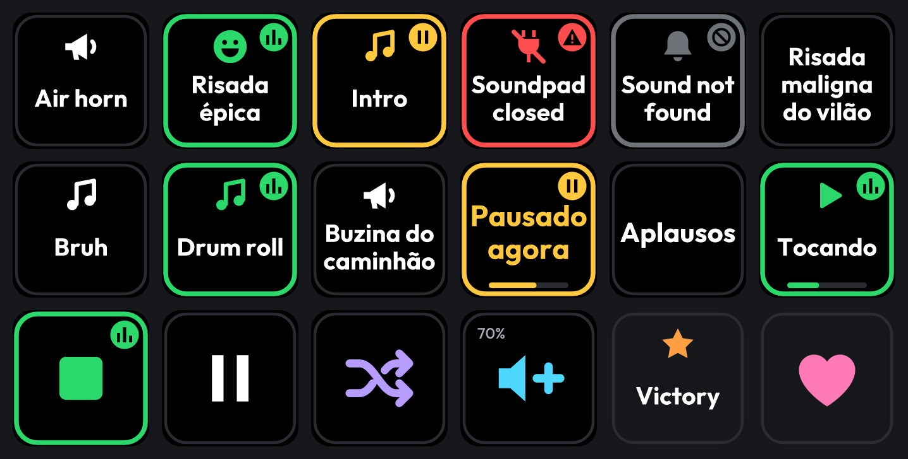

# Soundpad Controller

Play your [Soundpad](https://www.leppsoft.com/soundpad/) sounds from the keys of a Ulanzi D200, D200H or D200X. A plugin for [Ulanzi Studio](https://www.ulanzi.com/pages/ulanzi-app), for Windows.

**Status:** not released. The automated tests pass against a simulated Soundpad, but the plugin has not yet run with a real Soundpad, in the real Ulanzi Studio or on a device. [docs/VERIFY.md](docs/VERIFY.md) is the checklist for that first run.

- **Favorites:** any key plays one sound, on speakers, microphone or both. It keeps playing the right sound when you add, remove or reorder sounds in Soundpad.
- **Playback controls:** stop, pause, next, previous, random, replay and volume.
- **Clear state:** green while playing, yellow when paused, red when Soundpad is closed, grey when a sound is gone, each with its own mark too.
- **Local and light:** talks to Soundpad only on your computer, through Soundpad's own remote control. One connection for every key, nothing running while no key is on the deck.

## Em português

O Soundpad Controller toca os sons do Soundpad nas teclas do Ulanzi D200, D200H e D200X, no Windows. Tem favoritos fixos que continuam tocando o som certo mesmo depois de adicionar, remover ou reordenar sons; e controles de reprodução e volume. Conversa com o Soundpad só no seu computador e não envia nada pela internet. O painel de configurações e as mensagens das teclas estão em português e inglês. A instalação está em [docs/INSTALL.md](docs/INSTALL.md).

## Documentation

| | |
|---|---|
| [Installing](docs/INSTALL.md) | Windows, Soundpad, where the folder goes |
| [Using it](docs/USAGE.md) | Favorites, the library on your keys, outputs, controls, what the colors mean |
| [Troubleshooting](docs/TROUBLESHOOTING.md) | What each message means, logs |
| [Architecture](docs/ARCHITECTURE.md) | How it works inside |
| [Soundpad's remote control](docs/SOUNDPAD-API.md) | The commands used, and the limits of the interface |
| [Performance](docs/PERFORMANCE.md) | Measured CPU and memory |
| [Checking it on a device](docs/VERIFY.md) | The manual checklist before each release |
| [Patterns from Clima Pro](docs/REFERENCE-PATTERNS.md) | What this project shares with its sibling |

## Contributing

You do not need a device or Soundpad: the tests run the real plugin against a fake Studio and a simulated Soundpad. See [CONTRIBUTING.md](CONTRIBUTING.md). Report security problems as described in [SECURITY.md](SECURITY.md).

## License

[Apache-2.0](LICENSE). Bundled components are listed in [THIRD_PARTY_NOTICES.md](com.ulanzi.soundpadpro.ulanziPlugin/THIRD_PARTY_NOTICES.md).

Soundpad is a product of Leppsoft. This project is not affiliated with Leppsoft or Ulanzi.
